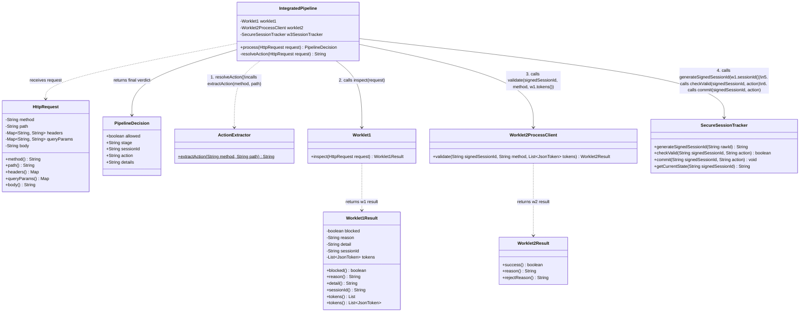
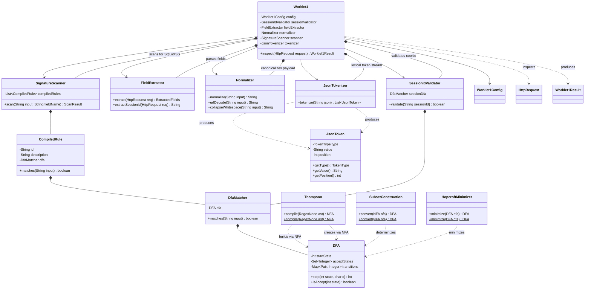
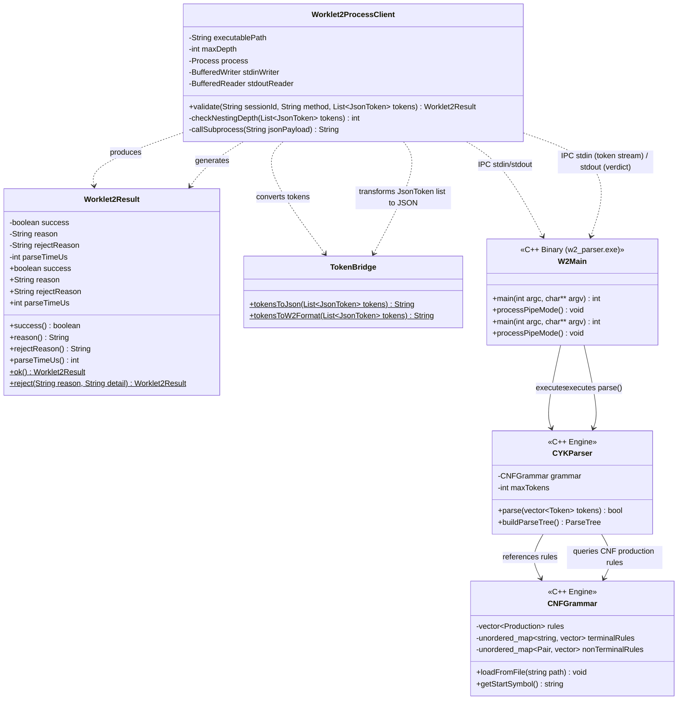
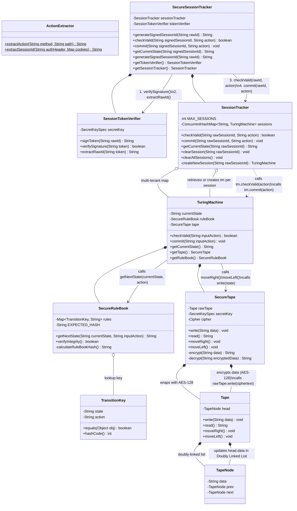

# WAF-Firewall: Comprehensive Architecture Class Diagrams

This document contains modular Mermaid class diagrams for each component of the Web Application Firewall (WAF) and shows how `IntegratedPipeline` coordinates them.
This document details the object-oriented structure of each worklet and explicitly maps the exact method invocations and data flows from `IntegratedPipeline.java`.

---

## 1. Worklet 1: Lexical Analysis, Regex DFA & Session Validation

## 1. Master Pipeline Call Flow: `IntegratedPipeline.java` Calling Each Worklet

Worklet 1 performs line-speed inspection of HTTP requests: signature scanning (SQLi, XSS, Path Traversal) via minimized DFAs, JSON tokenization, and cookie validation.
This diagram explicitly illustrates **how `IntegratedPipeline.process(HttpRequest)` invokes the entry-point methods of each worklet**, what inputs it passes, and what results it receives back.



---

## 2. Worklet 1 Internal Class Diagram: Lexical, Regex DFA & Tokens

Shows `Worklet1.inspect(HttpRequest)` delegating across its internal sub-components down to the automata algorithms.



---

## 2. Worklet 2: Structural CYK Parser & CNF Grammar (C++17)

## 3. Worklet 2 Internal Class Diagram: CYK Parser & CNF Grammar (C++17 Subprocess)

Worklet 2 runs as an isolated high-performance subprocess or native client to perform Chomsky Normal Form (CNF) grammar parsing, structural verification, and maximum JSON nesting depth checks.
Shows `Worklet2ProcessClient.validate(...)` communicating over pipes with the native C++17 CYK parser.



---

## 3. Worklet 3: Stateful Turing Machine & Cryptographic Session Engine

## 4. Worklet 3 Internal Class Diagram: Stateful TM & AES Tape

Worklet 3 manages multi-user stateful session tracking through a mathematically verified Turing Machine, HMAC-SHA256 session token authentication, in-memory SHA-256 rulebook integrity validation, and AES-128 encrypted tape memory.
Shows the complete call chain inside Worklet 3 when `checkValid()` and `commit()` are called:
`SecureSessionTracker` $\rightarrow$ `SessionTracker` $\rightarrow$ `TuringMachine` $\rightarrow$ `SecureRuleBook` & `SecureTape`.



---

## 4. Master Integration: `IntegratedPipeline` Calling All 3 Worklets

## 5. End-to-End Sequence of Method Invocations

This diagram demonstrates how [`IntegratedPipeline.java`](file:///e:/Kartikey%20A%20Dhale/Miniproject/WAF/WAF-Firewall/src/main/java/com/wafgateway/pipeline/IntegratedPipeline.java) serves as the central brain orchestrating the 3 worklets in sequence for every HTTP request.
For a quick reference of the exact execution sequence triggered by `IntegratedPipeline.process(HttpRequest)`:

```mermaid
classDiagram
    direction TB
sequenceDiagram
    autonumber
    actor Client
    participant IP as IntegratedPipeline
    participant AE as ActionExtractor
    participant W1 as Worklet1
    participant W2 as Worklet2ProcessClient
    participant SST as SecureSessionTracker
    participant STV as SessionTokenVerifier
    participant ST as SessionTracker
    participant TM as TuringMachine
    participant SRB as SecureRuleBook
    participant STape as SecureTape

    class WafReverseProxyServer {
        -int proxyPort
        -String targetBaseUrl
        -IntegratedPipeline pipeline
        -HttpClient httpClient
        +main(String[] args)$ void
        +start() void
        -handleProxyRequest(HttpExchange exchange) void
    }
    Client->>IP: process(request)
    IP->>AE: extractAction(method, path)
    AE-->>IP: "POST_LOGIN" (action)

    class IntegratedPipeline {
        -Worklet1 worklet1
        -Worklet2ProcessClient worklet2
        -SecureSessionTracker w3SessionTracker
        +process(HttpRequest request) PipelineDecision
        -resolveAction(HttpRequest request) String
        +getW3SessionTracker() SecureSessionTracker
    }
    %% Worklet 1
    IP->>W1: inspect(request)
    W1-->>IP: Worklet1Result(blocked=false, sessionId="raw123", tokens=[...])

    class PipelineDecision {
        <<record>>
        -boolean allowed
        -String stage
        -String sessionId
        -String action
        -String details
        +allowed() boolean
        +stage() String
        +sessionId() String
        +action() String
        +details() String
    }
    %% Token Signing
    IP->>SST: generateSignedSessionId("raw123")
    SST->>STV: signToken("raw123")
    STV-->>IP: "raw123.hmacSignature"

    class ActionExtractor {
        +extractAction(String method, String path)$ String
    }
    %% Worklet 2
    opt tokens not empty
        IP->>W2: validate(signedSessionId, method, tokens)
        W2-->>IP: Worklet2Result(success=true)
    end

    class Worklet1 {
        +inspect(HttpRequest request) Worklet1Result
    }
    %% Worklet 3 Verification
    IP->>SST: checkValid(signedSessionId, action)
    SST->>STV: verifySignature(signedSessionId)
    STV-->>SST: true
    SST->>STV: extractRawId(signedSessionId)
    STV-->>SST: "raw123"
    SST->>ST: checkValid("raw123", action)
    ST->>TM: checkValid(action)
    TM->>SRB: getNextState(currentState, action)
    SRB-->>TM: "AUTH:RIGHT"
    TM-->>ST: true
    ST-->>SST: true
    SST-->>IP: true (validTransition)

    class Worklet2ProcessClient {
        +validate(String sid, String method, List tokens) Worklet2Result
    }
    %% Worklet 3 Commit
    IP->>SST: commit(signedSessionId, action)
    SST->>ST: commit("raw123", action)
    ST->>TM: commit(action)
    TM->>STape: moveRight()
    TM->>STape: write("AUTH")
    Note over STape: AES-128 Encrypt & update TapeNode
    TM-->>IP: state updated to AUTH

    class SecureSessionTracker {
        +generateSignedSessionId(String rawId) String
        +checkValid(String signedId, String action) boolean
        +commit(String signedId, String action) void
        +getCurrentState(String signedId) String
    }

    WafReverseProxyServer --> IntegratedPipeline : 1. Dispatches incoming HTTP requests
    IntegratedPipeline ..> PipelineDecision : returns verdict (ALLOWED / BLOCKED)

    %% Coordination Sequence
    IntegratedPipeline ..> ActionExtractor : 2. Extracts Action (POST_LOGIN, POST_CART, etc.)
    IntegratedPipeline --> Worklet1 : 3. Invokes inspect() [Lexical / Regex / Signatures]
    IntegratedPipeline --> Worklet2ProcessClient : 4. Invokes validate() [CYK / CNF / Depth]
    IntegratedPipeline --> SecureSessionTracker : 5. Invokes checkValid() & commit() [Stateful TM / Tape]
    IP-->>Client: PipelineDecision(allowed=true, stage="Pipeline Complete")
```
